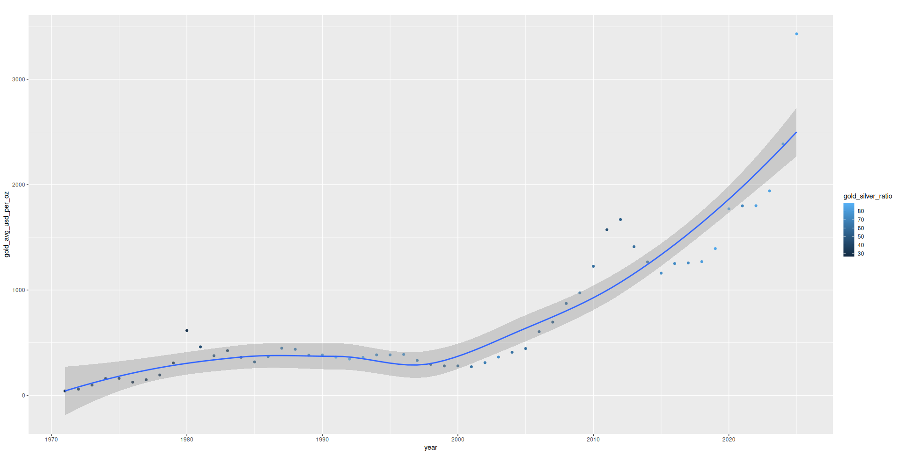
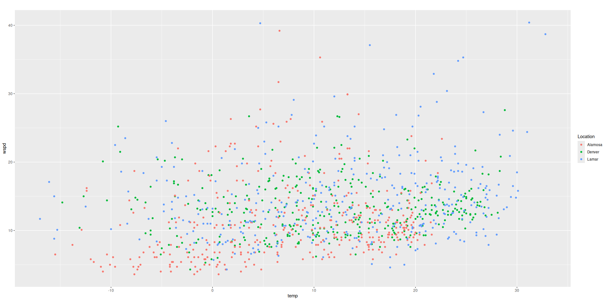
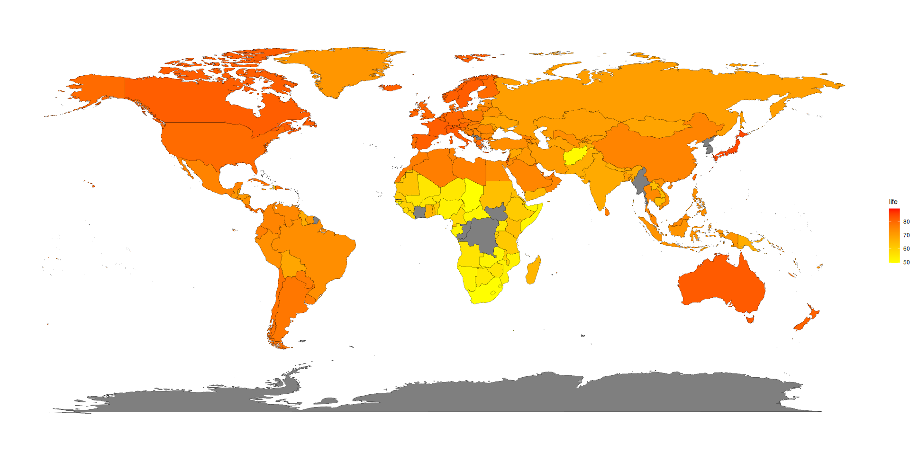
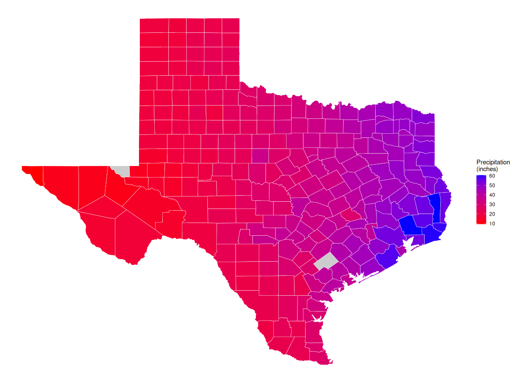
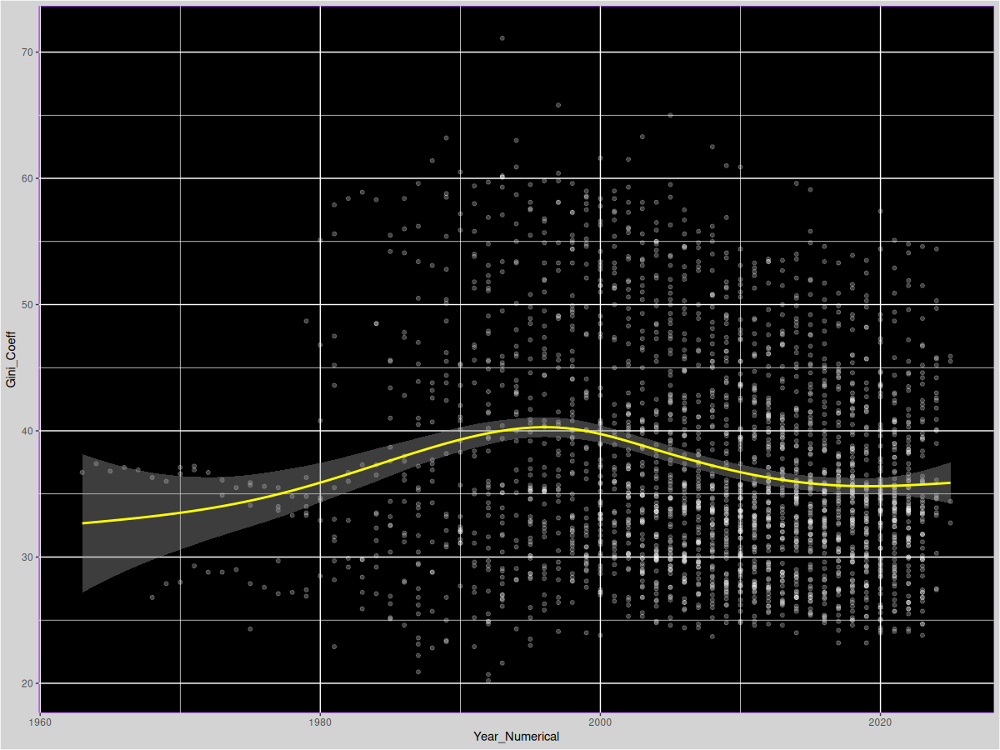
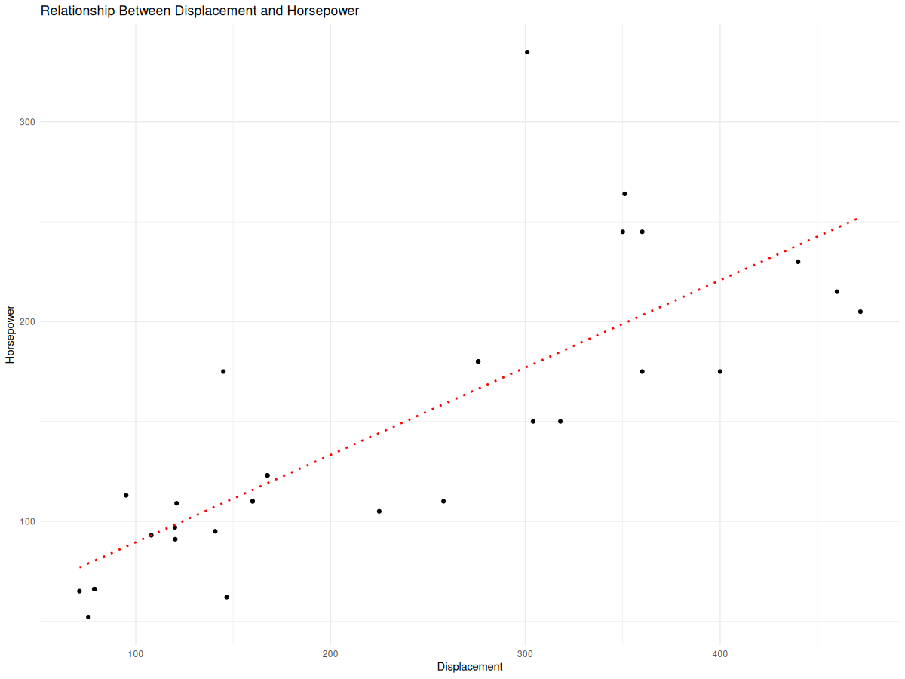
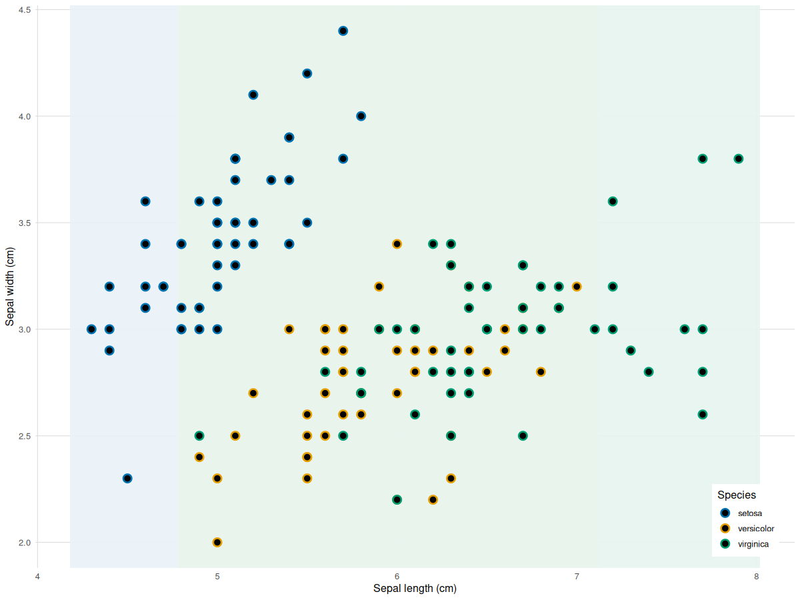
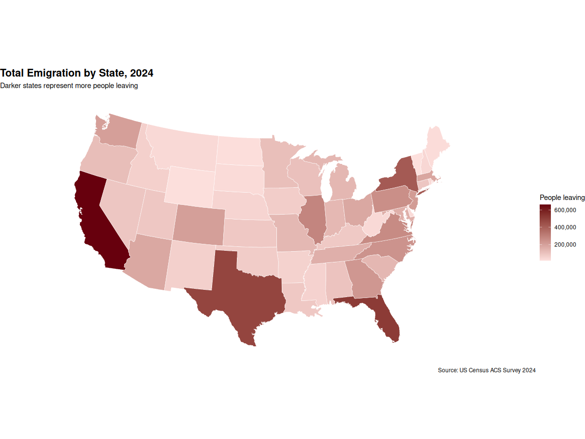

body {
  background-color: gray;
}

# Rashad Breaux
*Dat 2002*
**The Story of Gold**

***Summary***
Here is a display of the value of gold spanning all the way from the year 1970 to more recent years, such as 2020. Early development of gold and the economy shows that the price of gold in the past would be viewed as a “cheap” commodity by today’s standards. You can also notice that the price of gold between the years 1990 and about 2005 started to even out and stagnate, but then, after that, closer to 2010, the price of gold skyrocketed. One of those possibilities could stem from the state of the domestic economy and geopolitical reasons. Displayed on this graph is the ratio between gold and silver. This was another thing I found interesting because silver slowly started to become more prevalent in comparison to gold in price, even as high as 80% in the later years from 2020 closer to the present day.

Provided here is the link to the data that is displayed here.  

[source](https://ingoldwetrust.report/chart-performance-table-gold-silver/?lang=en)

**Windspeed Data**

***Summary***
Weather has many variables that can be measured, 2 of which are wind speed and temperature. Exactly placed here is a scatter plot displaying the relationship between the two in three different locations in the beautiful state of Colorado. Just looking at this scatterplot, I noticed a couple of things; one is between all three cities, as the temperature approaches 0 degrees Celsius, all the way to 20 degrees. The three locations have a relatively similar pattern. However, the city of Lamar does stand out as an outlier for the pattern. As the temperature increases, Lamar exponentially increases wind speed. Alamosa also breaks out the mold and has a massive increase in the middle temperatures. But Denver stays consistent the entire way. I do find this to be interesting because Denver is a more city/metropolitan area compared to Alamosa and Lamar. This fact, as well as population size, could play a part in why Denver is the only city that stays relatively in the middle of this entire scatterplot. 

[source](https://weatherspark.com/h/y/3709/2025/Historical-Weather-during-2025-in-Denver-Colorado-United-States)

***Summary***

Here is a world map of life expectancy by age on each continent. One thing I notice is that, overall, the world trend tends to be higher in the 70s and 80s, with a couple of outliers. This brings us to the continent of Africa. Unlike the majority, I find it more interesting that southern Africa has a much lower life expectancy between the ages of 50 and 60, while the northern part of Africa has a much higher expectancy between 70 and 80. The history of Africa and its geopolitical standing definitely play a big part in why it is the way it is.

 

***Summary***
This visual shows the rate of precipitation rate of each county in the big state of Texas. As Texas is a southern state, it does have a rather high rate of precipitation overall. But you do notice a slight pattern: the further east you look, the more towards Houston, closer to the state of Louisiana. The overall area has a significantly higher rate than the west side of Texas. You can almost notice a line that splits Texas between a wetter and drier state.     

 

 

[Interactive Display](https://ds.palladur.com/user/rbreaux2/files/Dat2002/Image_files/car_data_interactive.html?_xsrf=MnwxOjB8MTA6MTc5NDYzMjYxOXw1Ol94c3JmfDEzMjpNV1ZpTVdGa01qVTNNVGRsTkdRNU4ySTRaalV5WW1NNVlqTTJaV1kzWXpnNk16ZGlaVEU1WkRBeE0ySXhaakZtWm1Sa1l6TTNOMlJqTW1JNFltUXlOREl5T0dRMllqWm1NelF5WldKbE5qSTFNell5TkRFNU9XSmpabUl6TVRaaVpRPT18YjgyMDlmZTQxODlkZmZjM2QxMDBmNjMxNmJlMDYxM2U3YTIyOGRlMjNkMTljNGNjM2U4ZTRlMWNlZDY2ZWRkOQ)
***Summary*** 
This display illustrates the relationship between a vehicle's fuel efficiency, measured in miles per gallon (MPG), and the number of cylinders in its engine. As shown, a wide variety of brands offer four-cylinder vehicles, supporting the general trend that vehicles with fewer cylinders tend to achieve higher MPG. In contrast, most vehicles in this dataset have eight-cylinder engines and the lowest fuel efficiency.

 
***Summary***
Using the same dataset, I gathered additional information regarding the relationship between vehicle displacement—the cumulative volume displaced by the pistons, which correlates closely with power generation and towing capacity—and horsepower. Notably, the majority of vehicles fall on the low-to-medium end of the trend line, following the general pattern that a vehicle with a larger displacement produces more horsepower. 

 

 

Displayed here is the is the quantity of people leaving the U.S. to foreign countries 

[Interactive Display](https://ds.palladur.com/user/rbreaux2/files/Dat2002/Image_files/pq1.html?_xsrf=MnwxOjB8MTA6MTc5NDQ2MDQyNXw1Ol94c3JmfDEzMjpaRFl5T1RjMk1qTmlNekJtTkdGalltRXhPRGhpWVRnMk9XUXdPR0ppTUdRNlpETXhNR00zWm1VMll6UTVaRGd3WTJNMU1XTmlNMkV3TURGbE1EWmpPV1ZsTW1FMU9URmxaRGt6T0dVeE16UmpOVEl3T1RWak16SmxOVGRoTURsbFl3PT18N2IxYzFkOTNiODcwZWQ0NWE3MTg0MjdmMWE0YTFkMDBmMzA1OTk5Yjk4MjYxMmYxMjMyMzQxYzQ5M2Y4NzQ4OA
)
***Summary***
This link shows the top 5 states that foreigners traveled to in 2024. Typically, coastal states would be the expectation for a plethora of reasons, such as their popularity as travel destinations and major ports. What stands out is Ohio ranking as the 5th most-visited state by foreigners. Another point to notice is that Texas is ranked 1st by a considerable margin. Texas's continuous growth in popularity and business likely plays a part in why it is ranked number one, along with having major cities like Houston, Dallas, and the rapidly growing Austin.

[source](https://www.census.gov/data/tables/time-series/demo/geographic-mobility/state-to-state-migration.html)

[Interactive Display](my_sankey.html)

**software sources**
All graphs were created in RStudio 

